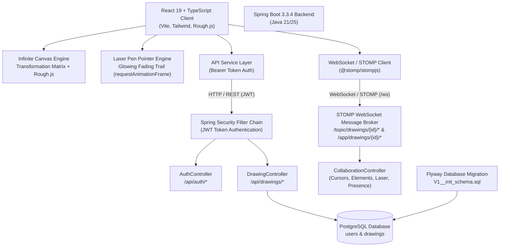

# Excalidraw Full-Stack Clone

A production-grade, hand-drawn sketch whiteboard clone of [Excalidraw](https://excalidraw.com/), built with **Spring Boot 3 (Java 21/25)**, **PostgreSQL with Flyway migrations**, **Spring Security + JWT**, **WebSocket / STOMP Real-Time Collaboration**, and **React 19 + TypeScript + Tailwind CSS + Vite + Rough.js**.

---

## 🎨 System Architecture



---

## 📁 Repository Structure

```
white_board/
├── backend/                             # Spring Boot 3 Backend
│   ├── src/main/java/com/excalidraw/
│   │   ├── config/                      # SecurityConfig, WebCorsConfig, WebSocketConfig
│   │   ├── controller/                  # AuthController, DrawingController, CollaborationController
│   │   ├── dto/                         # AuthRequest, CollaborationMessage, DrawingDto, etc.
│   │   ├── exception/                   # GlobalExceptionHandler, ResourceNotFoundException
│   │   ├── model/                       # User, Drawing JPA Entities
│   │   ├── repository/                  # UserRepository, DrawingRepository
│   │   ├── security/                    # JwtTokenProvider, JwtAuthenticationFilter, UserPrincipal
│   │   └── service/                     # AuthService, DrawingService
│   ├── src/main/resources/
│   │   ├── application.yml              # PostgreSQL + Flyway configuration
│   │   ├── application-dev.yml          # In-memory H2 development configuration
│   │   └── db/migration/
│   │       └── V1__init_schema.sql      # Flyway schema initialization
│   ├── src/test/java/com/excalidraw/    # Integration & Unit Tests
│   ├── mvnw & mvnw.cmd                  # Maven Wrapper
│   └── pom.xml                          # Maven build dependencies
│
└── frontend/                            # React 19 Client
    ├── src/
    │   ├── components/
    │   │   ├── Canvas.tsx               # Infinite canvas, Rough.js shapes, Laser trail & Remote cursors
    │   │   ├── Toolbar.tsx              # Floating top tool island (includes Laser Pen)
    │   │   ├── PropertiesSidebar.tsx    # Left side hand-drawn style panel
    │   │   ├── TopBar.tsx               # Hamburger menu, title editor, collaborate & cloud sync
    │   │   ├── ZoomControls.tsx         # Bottom-left zoom & undo/redo island
    │   │   ├── CollabModal.tsx          # Real-time room invitation & collaborator management
    │   │   ├── CommandPalette.tsx       # Searchable action overlay (Ctrl+/)
    │   │   ├── FindModal.tsx            # Find & pan to elements (Ctrl+F)
    │   │   ├── ExportModal.tsx          # PNG/SVG export modal (Ctrl+Shift+E)
    │   │   ├── AuthModal.tsx            # Sign in / Register modal
    │   │   ├── SavedDrawingsModal.tsx   # Cloud drawings browser
    │   │   └── HelpModal.tsx            # Keyboard shortcuts cheatsheet
    │   ├── hooks/
    │   │   ├── useHistory.ts            # Canvas undo/redo state management
    │   │   └── useCollaboration.ts      # Live STOMP WebSocket sync hook
    │   ├── services/
    │   │   ├── api.ts                   # Fetch client with JWT interceptor
    │   │   ├── authService.ts           # Authentication & token storage
    │   │   └── drawingService.ts        # Cloud drawing persistence
    │   ├── types/
    │   │   ├── canvas.ts                # Elements, shapes, laser trails & collaborator types
    │   │   └── api.ts                   # REST API interfaces
    │   ├── utils/
    │   │   ├── roughRenderer.ts         # Rough.js renderers & selection outlines
    │   │   ├── math.ts                  # Canvas transformation matrix & hit testing
    │   │   ├── export.ts                # PNG, SVG & clipboard export utilities
    │   │   └── excalidrawFile.ts        # .excalidraw JSON serialization
    │   ├── App.tsx                      # App orchestration
    │   └── index.css                    # Tailwind CSS + Virgil hand-drawn fonts
    ├── package.json
    ├── tailwind.config.js
    └── vite.config.ts
```

---

## ⚡ Real-Time Collaboration & Laser Pen Features

### 1. Real-Time Live Collaboration (WebSocket / STOMP)
- **Shareable Room Link**: Click the **Collaborate** button in the top bar to generate an invite link (e.g. `http://localhost:5173/?room=session-xyz`).
- **Live Remote Cursors**: See every collaborator's mouse pointer move across the canvas in their assigned distinctive color, labeled with their username badge.
- **Instant Element Sync**: Any element drawn, resized, moved, edited, or deleted is broadcasted in real time to all connected room participants.
- **Collaborator Presence**: Real-time join/leave tracking with online badges.

### 2. Laser Pen (Pointer Tool)
- **Shortcut `K`** or click the **Laser** tool on the toolbar.
- Draw temporary glowing neon laser trails that draw audience attention during presentations and live brainstorming sessions.
- **Glowing Fade Effect**: Points dynamically fade away after ~1.2s using an optimized `requestAnimationFrame` decaying trail renderer.
- **Collaborative Laser**: Remote collaborator laser strokes are broadcasted via WebSocket and rendered with glowing trails in each user's unique collaborator color.

### 3. QR Code Instant Mobile / LAN Connection
- In the **Collaborate** modal, an **instant QR code** is dynamically generated using `@types/qrcode`.
- Mobile users and teammates on the same local network (Wi-Fi) can simply scan the QR code with their smartphone camera or tablet to join the live whiteboard session instantly.
- Toggle between **Wi-Fi / LAN IP** (`http://<ip>:5173/?room=...`) and **Localhost** (`http://localhost:5173/?room=...`) directly in the modal.

---

## 🐳 Production Deployment with Docker Compose

A production-ready `docker-compose.yml` orchestrates PostgreSQL, the multi-stage Spring Boot backend, and the React frontend served with Nginx:

```powershell
docker-compose up --build -d
```

Services:
- **Frontend (Nginx + React SPA)**: `http://localhost:80` (with reverse proxy for `/api/` and WebSocket `/ws/`).
- **Backend (Spring Boot 3)**: `http://localhost:8080` (healthcheck at `/api/health`).
- **Database (PostgreSQL 16)**: `localhost:5432` (with persistent volume `postgres_data` and Flyway migrations).

---

## 🧪 Automated End-to-End Testing

Run the automated E2E test suite (11 tests covering health, auth, CRUD, partial updates, anonymous public access, and frontend availability):

```powershell
powershell -ExecutionPolicy Bypass -File .\test_e2e.ps1
```

All 11 tests run automatically and output color-coded test verification metrics.

---

## 🛠️ Local Development Setup

### 1. Backend (Spring Boot 3)
```powershell
cd backend
# Zero-config in-memory H2 dev mode:
.\mvnw.cmd spring-boot:run "-Dspring-boot.run.profiles=dev"

# Or with local PostgreSQL running on port 5432:
.\mvnw.cmd spring-boot:run
```

### 2. Frontend (React 19 + Vite)
```powershell
cd frontend
npm install
npm run dev -- --host
```
Open **`http://localhost:5173`** (or access via LAN IP on mobile devices).

---

## ⌨️ Keyboard Shortcuts Reference

| Shortcut | Action |
| :--- | :--- |
| `1` or `V` | **Selection Tool** |
| `2` or `H` | **Hand Tool** (Pan) |
| `3` or `R` | **Rectangle Tool** |
| `4` or `D` | **Diamond Tool** |
| `5` or `O` | **Ellipse Tool** |
| `6` or `A` | **Arrow Tool** |
| `7` or `L` | **Line Tool** |
| `8` or `P` | **Draw (Pencil) Tool** |
| `9` or `T` | **Text Tool** |
| `0` or `E` | **Eraser Tool** |
| `K` | **Laser Pen (Pointer Tool)** |
| `Ctrl + /` | **Command Palette** |
| `Ctrl + F` | **Find on Canvas** (with automatic viewport centering) |
| `Ctrl + Shift + E` | **Export Modal** (PNG / SVG with scale factor & clipboard copy) |
| `Ctrl + S` | **Save to `.excalidraw` file** |
| `Ctrl + O` | **Open `.excalidraw` file** |
| `Ctrl + Z` | **Undo** |
| `Ctrl + Y` | **Redo** |
| `Ctrl + D` | **Duplicate selected element(s)** |
| `Delete` / `Backspace` | **Delete selected element(s)** |
| `Space + Drag` | **Pan canvas viewport** |
| `Ctrl + Mouse Wheel` | **Zoom centered at mouse pointer** |
| `Shift + 0` | **Reset Zoom to 100%** |
| `?` | **Help & Keyboard shortcuts modal** |

---

## 🌐 WebSocket & REST Endpoints

### STOMP WebSocket Endpoints
- Handshake URL: `ws://localhost:8080/ws`
- Subscriptions:
  - `/topic/drawings/{id}/cursor` — Remote collaborator cursors
  - `/topic/drawings/{id}/elements` — Real-time element changes
  - `/topic/drawings/{id}/laser` — Laser pointer trail broadcasts
  - `/topic/drawings/{id}/presence` — Join / Leave events
- Publications:
  - `/app/drawings/{id}/cursor` — Send current mouse coordinate
  - `/app/drawings/{id}/elements` — Broadcast canvas elements
  - `/app/drawings/{id}/laser` — Broadcast laser stroke
  - `/app/drawings/{id}/presence` — Announce user presence
